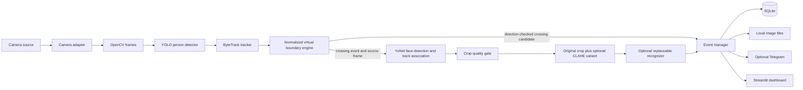

# System Architecture

The prototype is local-first. Camera-specific code is behind an adapter; the processing and event logic remain independent of the Streamlit interface. A virtual boundary crossing creates the primary event. Face processing and Telegram are optional enrichments and must not prevent local event creation or persistence.

The dashboard calls services and displays their status; it does not own detection, tracking, geometry, or persistence logic. Tracker IDs are temporary. Phase 5 runs face detection only when a crossing is confirmed and associates a detected face with that event's person box. It returns `no_face`, `face_not_in_crossing_track_box`, `low_quality`, or `unavailable` explicitly. The crop is held in memory by this phase; no face is written to disk or enrolled automatically. A missing, unknown, or inconclusive face is not a threat classification and cannot cancel the crossing event. CLAHE creates a separate luminance-enhanced variant; the original crop remains available for comparison. The initial DroidCam-over-Wi-Fi path is replaceable by a webcam, test video, or another adapter that meets the camera contract. Actual operating-system and camera combinations are supported only after being tested and documented.

Phase 4 keeps geometry and crossing state in `app/boundary.py`, independent of the OpenCV editor. The editor is a temporary operator tool; Phase 7 can replace it with Streamlit controls while reusing the same boundary configuration and engine. Its JSON settings file is local-only until the Phase 6 database settings layer is implemented.

See [INTERFACES.md](INTERFACES.md) for the initial contracts and [DECISIONS.md](DECISIONS.md) for unresolved choices.
