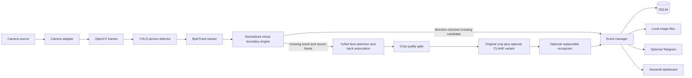

# System Architecture

The prototype is local-first. Camera-specific code is behind an adapter; the processing and event logic remain independent of the Streamlit interface. A virtual boundary crossing creates the primary event. Face processing and Telegram are optional enrichments and must not prevent local event creation or persistence.

The dashboard calls services and displays their status; it does not own detection, tracking, geometry, or persistence logic. Tracker IDs are temporary. Phase 5 runs face detection on a confirmed crossing frame and associates a detected face with that event's person box. It returns `no_face`, `face_not_in_crossing_track_box`, `low_quality`, or `unavailable` explicitly. Phase 6 saves captured original and CLAHE face crops as local image files and stores only their paths and metadata in SQLite. A missing, unknown, or inconclusive face is not a threat classification and cannot cancel the crossing event. The original crop remains available alongside the optional luminance-enhanced variant. The initial DroidCam-over-Wi-Fi path is replaceable by a webcam, test video, or another adapter that meets the camera contract. Actual operating-system and camera combinations are supported only after being tested and documented.

`SQLiteRepository` owns event, boundary, identity, and generic settings persistence. `EventManager` saves local images when available, writes the event row idempotently, then invokes an optional alert adapter. Telegram errors are recorded as delivery status after the local commit; alert availability is not part of event creation. The default local store is `data/events.sqlite3` plus `data/event_images/`, both Git-ignored. A legacy per-camera boundary setting is imported from `data/boundaries.json` on the first Phase 6 preview run if no SQLite setting exists.

Phase 4 keeps geometry and crossing state in `app/boundary.py`, independent of the OpenCV editor. The editor is a temporary operator tool; Phase 7 can replace it with Streamlit controls while reusing the same boundary configuration and engine. Phase 6 stores boundary settings in SQLite and imports legacy JSON settings when needed.

See [INTERFACES.md](INTERFACES.md) for the initial contracts and [DECISIONS.md](DECISIONS.md) for unresolved choices.
